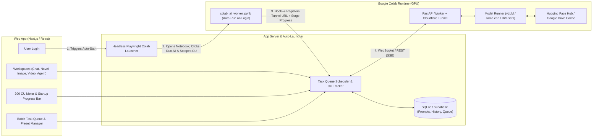

# Product Requirements Document (PRD): Colab AI Studio & Compute Orchestrator

## 1. Overview & Vision
**Product Name:** Colab AI Studio  
**Objective:** Build a web application that seamlessly connects to Google Colab runtimes (leveraging the user's 200 Compute Units allocation) to serve as an all-in-one personal AI workstation. The platform enables interactive chat, long-form novel writing, image/video generation, autonomous safe agent workflows, Hugging Face model switching, and automated batch task queuing—while providing real-time visibility into Colab startup progress and Compute Unit (CU) consumption.

---

## 2. Target Audience & Use Cases
- **AI Creators & Writers:** Users who want unrestricted, cost-effective access to open-source LLMs and diffusion/video models on Hugging Face using their existing Colab Pro/Pay-As-You-Go compute units.
- **Power Users & Indie Developers:** Users who need to queue up heavy batch jobs (e.g., generating 50 chapter drafts, batch rendering images/videos, or running multi-step agent tasks) sequentially without babysitting the notebook.

---

## 3. Core Features & Functional Requirements

### 3.1 Authentication, Colab Setup & Zero-Touch Auto-Run on Login
- **One-Time Colab Setup Wizard:**
  - **Auto-Provision Worker Notebook:** On first setup, the app automatically uploads a pre-configured `colab_ai_worker.ipynb` notebook into the user's Google Drive (`MyDrive/ColabAIStudio/colab_ai_worker.ipynb`) via Google Drive API.
  - **Session / Credential Binding:** Stores the user's Google session profile (via persistent Playwright browser context or Google OAuth + Colab Notebook Executor) along with a unique `BACKEND_WEBHOOK_URL`, `WORKER_AUTH_TOKEN`, and optional `HF_TOKEN`.
- **Zero-Touch Auto-Run on Website Login:**
  - **Automatic Wake-Up Trigger:** As soon as the user logs into the website, the backend checks if an active Colab worker heartbeat exists. If not, the **Colab Auto-Launcher Service** automatically opens the notebook URL in a headless/background browser session (or Colab execution bridge), selects the configured GPU tier (T4 / L4 / A100), and triggers **"Run All" (`Ctrl+F9`)** automatically—no manual tab opening or URL copy-pasting required.
  - **Auto-ApprovePrompts:** The automation layer automatically handles Colab's *"Warning: This notebook was not authored by Google"* and *"Permit this notebook to access your Google Drive files"* dialogs.
  - **Self-Registering Reverse Tunnel:** Once the notebook boots, it launches a Cloudflare Quick Tunnel (`cloudflared`) or Ngrok tunnel and immediately sends a `POST /api/colab/register` webhook to the website backend with its live tunnel URL and hardware specs.
  - **Keep-Alive & Auto-Reconnect:** Background heartbeat ping prevents Colab's browser-idle disconnect while tasks are active or queued, and automatically re-triggers the notebook if a session drops mid-queue.
- **Colab Startup Progress Bar:**
  - Triggered immediately upon website login while the auto-launcher boots the Colab notebook in the background.
  - Displays granular real-time startup stages streamed via webhook/SSE with elapsed & estimated remaining time:
    1. *Launching Headless Colab Session & Requesting GPU Runtime (T4 / L4 / A100)* (~5–15s)
    2. *Mounting Google Drive & Installing/Verifying Cached Dependencies* (~10–25s)
    3. *Downloading / Loading Hugging Face Model Weights into VRAM* (~20–90s)
    4. *Starting FastAPI Worker, Registering Tunnel & Health Check Ready* (~5s)
- **Auto-Disconnect / Idle Protection:** Configurable idle timeout that executes `google.colab.runtime.unassign()` to immediately terminate the runtime after all queued tasks finish, preventing wasted Compute Units.

### 3.2 Compute Unit (CU) Balance Meter & Telemetry
- **200 CU Budget Tracker & Auto-Sync:**
  - Visual gauge/meter in the top navigation bar showing **Remaining Compute Units** out of 200 CU (e.g., `142.5 / 200.0 CU`).
  - **Auto-Scrape Live CU Balance:** During the automated Colab login/startup phase, the headless Colab launcher inspects the Colab UI *"Resource Monitor / View Resources"* pane to extract the exact live Compute Unit balance and active burn rate directly from Google Colab, syncing it to the dashboard automatically.
  - **Real-Time Burn Rate Calculation:** Tracks consumption between syncs based on active GPU tier (e.g., T4 ≈ 1.96 CU/hr, L4 ≈ 4.82 CU/hr, A100 ≈ 13.11 CU/hr) multiplied by active session duration, with manual override/calibration support.
  - **Session Cost & ETA:** Displays current session CU spent, estimated time remaining before hitting a user-defined warning threshold (e.g., warn at 20 CU left), and historical CU usage per task type.
  - **Hardware Telemetry:** Live VRAM, System RAM, Disk, and GPU utilization bars polled from the Colab instance (`nvidia-smi`).

### 3.3 Multi-Modal Workspaces
1. **Interactive Chat:**
   - Streaming markdown responses, code highlighting, conversation branching, and context window token counter.
2. **Novel & Long-Form Writing Studio:**
   - Dedicated document editor with Story Bible / Lorebook management (characters, world-building, plot outlines).
   - Chapter-by-chapter generation, inline "Rewrite / Expand / Describe" tools, and consistency context injection.
3. **Image Generation Studio:**
   - Support for Text-to-Image and Image-to-Image pipelines (e.g., Flux, SDXL, Stable Diffusion 3.5 via Hugging Face `diffusers`).
   - Controls for resolution, steps, CFG scale, seed, LoRA weights, and gallery preview.
4. **Video Generation Studio:**
   - Text-to-Video and Image-to-Video generation (e.g., Wan2.1, CogVideoX, HunyuanVideo, LTX-Video).
   - Frame rate, duration, motion strength controls, and inline MP4 playback/download.
5. **Safe Autonomous Agent Mode:**
   - Curated, reliable, and sandboxed agent profiles (e.g., *Research Analyst*, *Novel Plot Architect*, *Prompt Engineer*, *Code Reviewer*).
   - **Safety Guardrails:** Read-only or confirmation-gated tool execution, loop detection, max-iteration caps, and output validation to ensure agents behave predictably without wasting compute or performing unsafe actions.

### 3.4 Prompt Assistant & System Prompt Configuration
- **Quality Prompt Enhancer ("Magic Wand"):**
  - One-click prompt refiner that transforms short/rough ideas into structured, high-performing prompts tailored to the active modality (LLM system instructions, detailed literary prose prompts, or comma-separated/natural-language diffusion & video prompts).
- **System Prompt Presets & Configuration:**
  - Built-in library of presets (*Creative Novelist*, *Uncensored Roleplay/Fiction*, *Strict Coding Assistant*, *Cinematographer Prompt Builder*).
  - Custom preset builder allowing users to save, tag, import/export, and version their own system prompts.
  - Full inference parameter tuning: Temperature, Top-P, Top-K, Repetition Penalty, Max New Tokens, and Context Length.

### 3.5 Hugging Face Model Manager
- **Dynamic Model Switcher:**
  - Browse and load models directly by Hugging Face Repo ID (e.g., `meta-llama/...`, `Qwen/...`, `black-forest-labs/FLUX.1-dev`).
  - Support for quantization formats (`GGUF`, `AWQ`, `GPTQ`, `bitsandbytes 4-bit/8-bit`) to fit within Colab T4/L4 VRAM limits.
  - **Google Drive Model Cache:** Option to cache frequently used model weights on Google Drive to drastically reduce Colab startup times on subsequent logins.
  - Token management for gated Hugging Face repositories (`HF_TOKEN`).

### 3.6 Batch Task Queue & Sequential Auto-Runner
- **Unified Task Queue Manager:**
  - Users can add single or batch jobs across any modality (e.g., *"Generate Chapters 1–5"*, *"Render 20 character concept images"*, *"Generate 3 video clips"*) into a persistent queue.
- **Sequential Auto-Execution:**
  - Automatically starts the next task in the queue as soon as the current task completes.
  - Handles automatic model swapping between tasks if a queued image task follows a text task (unloading LLM weights from VRAM before loading Diffusion weights).
- **Queue Controls & Fault Tolerance:**
  - Drag-and-drop priority reordering, Pause/Resume queue, Cancel current task, and Auto-Retry (up to $N$ times) on OOM or transient errors.
  - **Post-Queue Action:** Option to automatically disconnect and terminate the Colab runtime once the queue reaches 0 remaining tasks to save Compute Units.

---

## 4. System Architecture & Colab Auto-Launch Flow

### 4.1 Colab Worker Notebook (`colab_ai_worker.ipynb`) Structure
The auto-provisioned notebook contains 4 automated cells designed to execute top-to-bottom without human input:
1. **Cell 1 — Telemetry & Webhook Bootstrap:** Connects to the website backend to report `Stage 1 (GPU Allocated: T4/L4/A100)` and starts a background thread streaming `nvidia-smi` VRAM/GPU metrics.
2. **Cell 2 — Google Drive Mount & Cache Setup:** Mounts `/content/drive`, links `/content/drive/MyDrive/ColabAIStudio/models` as `HF_HOME` (so Hugging Face models only download once), and reports `Stage 2 (Drive & Dependencies Ready)`.
3. **Cell 3 — Model Engine Initialization:** Loads the default or queued Hugging Face model (`transformers` / `vLLM` / `llama-cpp-python` / `diffusers`) into GPU VRAM and reports `Stage 3 (Model Weights Loaded)`.
4. **Cell 4 — FastAPI Server & Reverse Tunnel:** Starts the FastAPI worker + `cloudflared` tunnel, registers the public tunnel endpoint with the web app, and reports `Stage 4 (100% Ready)`. Includes an endpoint `/shutdown` that executes `from google.colab import runtime; runtime.unassign()` when the batch queue finishes.

---

## 5. User Flow
1. **One-Time Setup:** User connects their Google account once and selects their preferred default GPU (e.g., T4 or L4) and initial CU balance (200 CU). The system deploys `colab_ai_worker.ipynb` to their Google Drive.
2. **Zero-Touch Login & Auto-Run:** User logs into the website. Immediately, the backend launches the Colab notebook in the background, bypasses confirmation prompts, and executes all cells.
3. **Live Startup Progress Bar:** While Colab boots, the dashboard shows a live progress bar with elapsed time, current stage (GPU Allocation -> Drive Mount -> Model Load -> Tunnel Ready), and ETA.
4. **Configure & Enhance:** User selects a workspace (*Chat*, *Novel*, *Image*, *Video*, or *Agent*), picks a Hugging Face model, selects a System Prompt preset, and uses the **Prompt Assistant** to refine their input.
5. **Queue & Walk Away:** User queues multiple tasks in the **Batch Task Queue** and enables *"Auto-shutdown Colab when queue finishes"*.
6. **Monitor CU Balance:** The top bar displays live remaining units out of **200 Compute Units** (synced from Colab's resource monitor + real-time burn rate) as each task finishes and auto-advances to the next.

---

## 6. Non-Functional Requirements
- **VRAM Safety:** Automatic garbage collection (`torch.cuda.empty_cache()`) between model switches and batch tasks to prevent CUDA Out-Of-Memory crashes on Colab GPUs.
- **Persistence:** All generated text, images, videos, and queue states are saved automatically to the web database / Google Drive so nothing is lost if Colab disconnects.
- **Responsive UI:** Clean dark-mode studio interface with persistent sidebars for the Task Queue and Compute Unit telemetry.

---

## 7. Phased Roadmap
- **Phase 1 (MVP):** Web UI shell, Colab connection & startup progress bar, 200 CU meter tracker, Chat + System Prompt Presets, and Prompt Enhancer.
- **Phase 2 (Multi-Modal & Queue):** Batch Task Queue with auto-advance, Novel Writing workspace, and Hugging Face dynamic model loader.
- **Phase 3 (Media & Agents):** Image & Video generation studios with VRAM auto-swapping, and Safe Autonomous Agent workflows.
